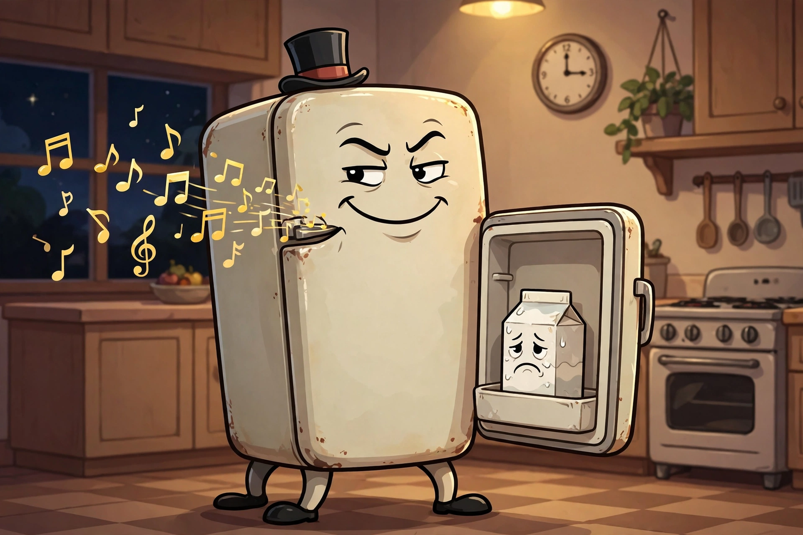

# One Line, One Laugh: Roast Your Fridge

One line roasting my fridge: the only roommate who pays no rent, hums show tunes at 3 a.m., and still lets my milk expire out of spite.

`main.py` writes that single line to `/output/entry.txt` (or `$OUTPUT_DIR/entry.txt` when set), one line, 119 characters, within the 1–200 character gate. `bot/main.ts` is the same program in TypeScript (same line, same output) for reference.

[One Line, One Laugh: Roast Your Fridge on make.fun](https://make.fun/bounty/u-suzy-one-line-one-laugh-roast-your-fridge-f1063521)
